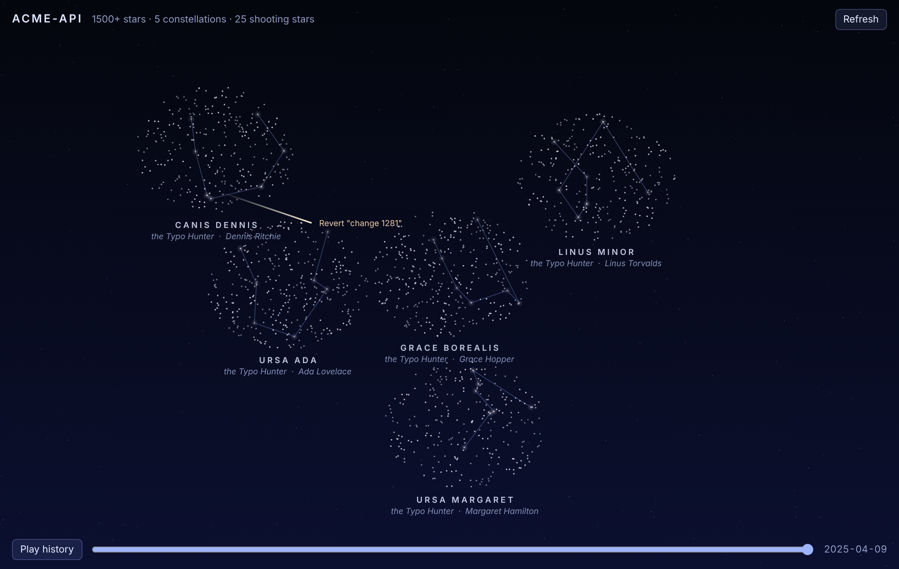

# git-sideshow

Just-for-fun canvas plugins for the GitHub Copilot app, all in one plugin marketplace.

| Plugin | What it does |
|---|---|
| [Commit Constellations](#commit-constellations) | Your git history as a night sky: commits are stars, authors are constellations, reverts are shooting stars. |
| [Build Horoscope](#build-horoscope) | A daily horoscope for your branch, read from real git signals. Mercury is in retrograde and so is your branch. |
| [Standup Séance](#standup-séance) | A spirit board summons your commits from yesterday or the last 7 days and spells out your standup. |
| Git Weather Channel | *Planned.* Repo churn as a weather forecast. |
| Dependency Tarot | *Planned.* Past, present and future, drawn from your dependencies. |

> Status: all three canvases are implemented and tested against an SDK stub. They have not yet been run inside the Copilot app: follow [docs/prompts/00-manual-test.md](docs/prompts/00-manual-test.md). See [docs/ROADMAP.md](docs/ROADMAP.md).

The screenshots below are mockups: headless Chromium against fixture repos (regenerate with `node docs/mocks/generate.mjs`). Your own repo renders the same way.

## Commit Constellations

Every commit is a star, every author a named constellation with an epithet ("the Midnight Committer"), and reverts streak past as shooting stars. Hover a star for its commit, scrub or play the history, and ask Copilot to spotlight an author.

- Install: `commit-constellations@git-sideshow`
- Ask: "show me the commit sky"
- Skill: `read-commit-sky` · Spec: [docs/specs/commit-constellations.md](docs/specs/commit-constellations.md)

## Build Horoscope

Your branch gets a developer zodiac sign (from its birth month) and a wheel of planets driven by real signals: commits behind, stashes, days since sync and more. A rule-based reading appears at once; Copilot's reading replaces it.

- Install: `build-horoscope@git-sideshow`
- Ask: "cast my build horoscope"
- Skill: `cast-build-horoscope` · Spec: [docs/specs/build-horoscope.md](docs/specs/build-horoscope.md)

## Standup Séance

A spirit board summons your own commits (all local branches, yesterday or the last 7 days), spells a headline with the planchette, and shows the standup Copilot wrote on parchment, ready to copy.

- Install: `standup-seance@git-sideshow`
- Ask: "hold a standup seance"
- Skill: `hold-standup-seance` · Spec: [docs/specs/standup-seance.md](docs/specs/standup-seance.md)

## Install (once released)

In the GitHub Copilot app: **Customize → Plugins**, add the marketplace `mbaic/git-sideshow`, then install a plugin. CLI: `copilot plugin marketplace add mbaic/git-sideshow`, then `copilot plugin install <plugin>@git-sideshow`.

## How this repo is built

The specs in [docs/specs](docs/specs) describe every plugin. Development runs one phase per session with an AI agent; the agent's working rules are in [CLAUDE.md](CLAUDE.md).

## License

MIT

## Tests

`node --test` (Node 20+, no dependencies).
