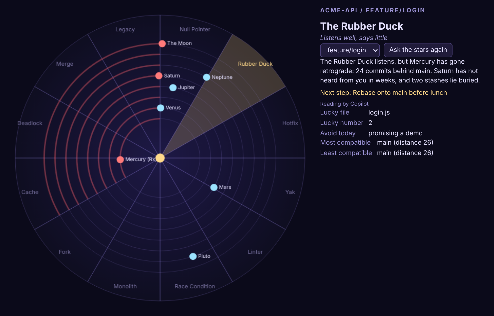
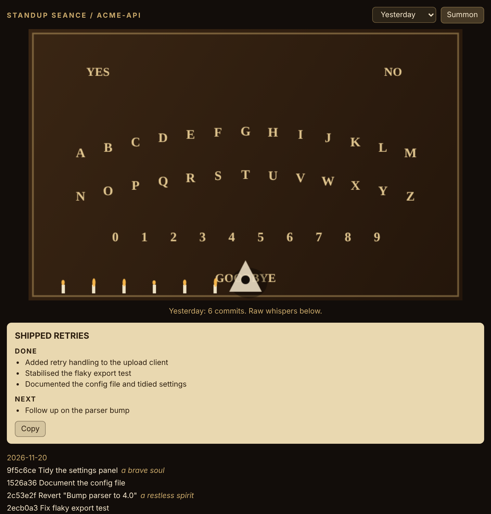

# git-sideshow

Just-for-fun canvas plugins for the GitHub Copilot app, all in one plugin marketplace.

| Plugin | What it does |
|---|---|
| Commit Constellations | Your git history as a night sky: commits are stars, authors are constellations, reverts are shooting stars. |
| Build Horoscope | A daily horoscope for your branch, read from real git signals. Mercury is in retrograde and so is your branch. |
| Standup Séance | A spirit board summons your commits from yesterday or the last 7 days and spells out your standup. |
| Git Weather Channel | *Planned.* Repo churn as a weather forecast. |
| Dependency Tarot | *Planned.* Past, present and future, drawn from your dependencies. |

## Mockups

Screenshots from headless Chromium against fixture repos (regenerate with `node docs/mocks/generate.mjs`). Real use will look the same, drawn from your own repo.

| Commit Constellations | Build Horoscope | Standup Séance |
|---|---|---|
|  |  |  |

> Status: all three canvases are implemented and tested against an SDK stub. They have not yet been run inside the Copilot app: follow [docs/prompts/00-manual-test.md](docs/prompts/00-manual-test.md). See [docs/ROADMAP.md](docs/ROADMAP.md).

## Install (once released)

In the GitHub Copilot app: **Customize → Plugins**, add the marketplace `mbaic/git-sideshow`, then install a plugin.

## How this repo is built

The specs in [docs/specs](docs/specs) describe every plugin. Development runs one phase per session with an AI agent; the agent's working rules are in [CLAUDE.md](CLAUDE.md).

## License

MIT

## Tests

`node --test` (Node 20+, no dependencies).
